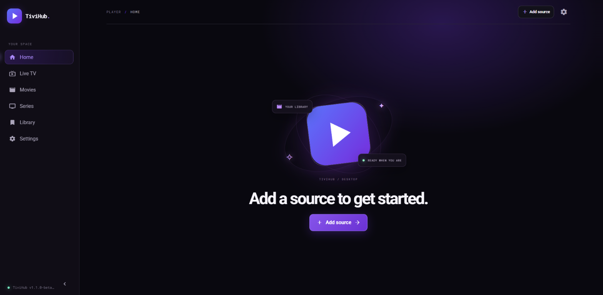
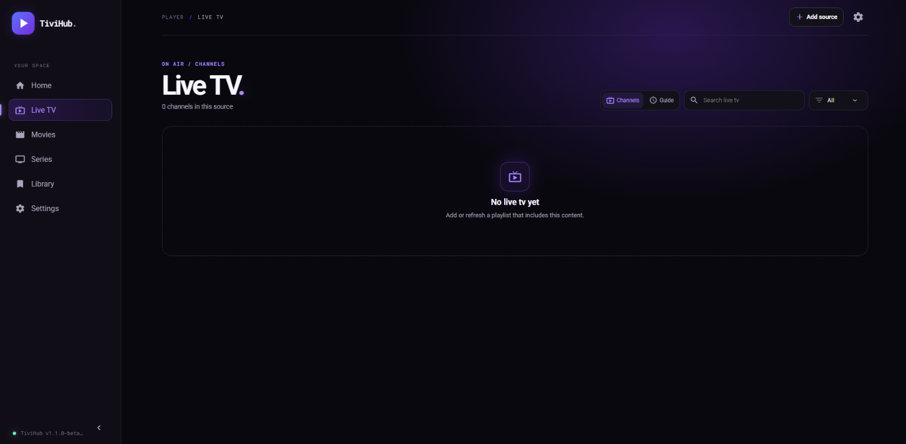
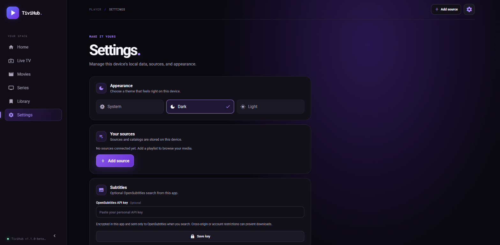

  

<h1 align="center">TiviHub</h1>

  <strong>Your media, organized your way.</strong> 
  An open-source desktop player for sources you choose.

  <a href="https://tivihub.nl">Website</a>
  &nbsp;·&nbsp;
  <a href="https://github.com/TiviHub/TiviHub/releases/download/v1.3.0/TiviHub-setup.exe">Download for Windows</a>
  &nbsp;·&nbsp;
  <a href="https://github.com/TiviHub/TiviHub/releases">All releases</a>
  &nbsp;·&nbsp;
  <a href="./LICENSE">MIT License</a>

TiviHub brings the media sources you configure into one desktop library. Browse live channels and guide data, movies, series, and episodes, then keep favorites and playback progress together on your device.

TiviHub is a player and organizer, not a content service. It does not provide playlists, channels, streams, or media. You bring sources you are authorized to use.

## Screenshots

<table>
  <tr>
    <td width="33%" align="center"></td>
    <td width="33%" align="center"></td>
    <td width="33%" align="center"></td>
  </tr>
  <tr>
    <td align="center"><strong>Home</strong></td>
    <td align="center"><strong>Live TV</strong></td>
    <td align="center"><strong>Settings</strong></td>
  </tr>
</table>

Real app screenshots captured with no source connected; no playlist or provider data is shown.

## What you can do

- **Connect your sources:** Import an M3U file or URL, or configure an Xtream-compatible source.
- **Keep catalogs ready:** Remote catalogs are cached on your device and refresh automatically every 24 hours; you can refresh them manually at any time.
- **Keep your library organized:** Browse live TV, programme guide data, movies, series, and episodes in one place.
- **Pick up where you left off:** Save favorites and playback progress on your device.
- **Cast to Google Cast devices:** Send compatible, unprotected streams directly from the provider to a Chromecast on your local network.
- **Make it yours:** Choose a light, dark, or system theme.
- **Back up your data:** Export and restore an encrypted backup when moving to another device.

Playback supports compatible HLS and DASH streams. Whether a particular stream works depends on your provider, authorization, network, CORS policy, codecs, and Windows WebView2.

## Download

**[Download TiviHub v1.3.0 for Windows 10/11 (64-bit)](https://github.com/TiviHub/TiviHub/releases/download/v1.3.0/TiviHub-setup.exe)**

The installer is unsigned; Windows may show an unknown-publisher or SmartScreen warning.

Windows is currently the only released platform. Linux is not available yet, and macOS is not currently targeted. Visit [GitHub Releases](https://github.com/TiviHub/TiviHub/releases) for the current installer and release notes.

## Privacy and local data

The installed player runs with its interface and assets bundled. It has no TiviHub account, application server, analytics, cloud sync, or automatic installer. The app checks the public GitHub Releases API for updates; it does not send playlists or library data in that request, and updates are downloaded and installed manually.

When you check for updates, GitHub receives a request from your network address. When you connect a remote source, refresh content, play media, or search for subtitles, TiviHub connects directly to the provider or subtitle service you configured. Those services receive the request and your network address; TiviHub does not proxy or relay it. Installer downloads are served by GitHub, not by the TiviHub website host.

When you cast, TiviHub sends the stream URL over your local network to the selected Chromecast, which then requests the stream directly from your provider. URLs may contain provider credentials. Only cast to devices you trust and that are on your local network.

Keep backups of important data. Clearing app data or losing access to your device can remove your local library. Local storage does not protect data from malware, a compromised operating-system account, or access to an unlocked device.

## Playback and content

Protected playback requires authorization and a DRM license service from your source. DRM and codec support vary by provider and device. TiviHub does not supply licenses or bypass DRM or other access controls.

Google Cast supports unprotected streams only. The Chromecast must be able to reach the provider and support the stream format; provider CORS or network restrictions may prevent playback. Cast playback progress and external subtitle selections are not synchronized to TiviHub.

You are responsible for using sources and content you are authorized to access and for following applicable law and provider terms. Third-party media, programme data, artwork, names, and trademarks remain the property of their respective owners.

## Open source and contributions

The source code is public so you can inspect how TiviHub works. **You do not need to build it yourself to use the app**—download the Windows installer above.

Suggestions, bug reports, and code contributions are welcome. Open an issue to discuss a change or submit a pull request. See [CONTRIBUTING.md](./CONTRIBUTING.md) for contributor guidance and [SECURITY.md](./SECURITY.md) for reporting security issues privately.

## License

TiviHub software is distributed under the [MIT License](./LICENSE). This license applies to the software only and does not grant rights to third-party content or brands.
